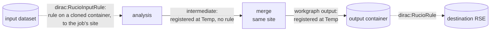

# DX-ADR-010: Rucio data management for workgraphs

## Metadata

- **Created By:** dciangot
- **Date:** 2026-10-16
- **Status:** Draft
- **Decision Maker(s):** TBD
- **Stakeholders:** Communities whose DiracX installation uses Rucio as its DM tool (catalogue excluded)

## Abstract

This ADR fills the open issue "Rucio rules for workgraph outputs" left by DX-ADR-008 and extends it to the input side. It builds on the Transformation System ADRs DX-ADR-002 to DX-ADR-009 proposed in [DIRACGrid/diracx#1042](https://github.com/DIRACGrid/diracx/pull/1042), and changes none of their decisions; the few core additions it needs are listed in Open Issues.

A workgraph running in a Rucio installation can ask for two things:

- **Input rules.** Each input Rucio dataset is held by one Rucio rule at the storage element (RSE) of the site its jobs will run at, recalled from tape if need be. The rule is placed on a clone of the input container that belongs to the transformation, and the original dataset is attached to it. It is declared on the workgraph input with a new `dirac:RucioInputRule` hint field. No parcel is created until its dataset is complete at the destination. This is done by a packer that wraps the community's own packer and delays each input while its dataset is on its way.
- **Output transfer.** Each output file is registered where the job wrote it. A final output is then moved to its destination by one rule, declared on the workgraph output with a new `dirac:RucioRule` hint field. An intermediate output is registered where it was written and gets no rule; its consumer, for example a merge step, runs at the same site.

Rucio stays what DX-ADR-008 says it is: a system of standing declarations, not a data backend. No parcel is ever made of a rule. DiracX creates rules, records them in an extension table, polls their state from packers and actions, renews their lifetime from a hook while inputs still need them, and shortens it when it is done with them. Everything specific to Rucio lives in extension plugins and in the installation's catalogue implementation; the core gains a registration interface, the wrapping of a packer by an input hint, and a read-only view of live inputs (see Open Issues).

## Motivation

DX-ADR-008 makes data management transformations RMS-driven and leaves Rucio to the communities: "declaring in the workgraph document that an output should carry a Rucio rule [...] is wanted by installations that use Rucio. Who creates the rule, who owns its lifetime, and what a workgraph's cleaning does to it are open." CMS needs an answer before it can run non-MC workflows on DiracX. CMS already uses Rucio on both sides of a job:

- **Input.** When a dataset is only on tape, or not at a site the user may run at, CMS creates a Rucio rule. The task waits until the rule is `OK` and is only then split into jobs, which run where the data is. Processing on disk-resident data relies on Rucio having placed it at the job's site.
- **Output.** A job stages its output out to a local "temporary" area of the site it ran at. The file is then registered in Rucio under its final LFN and attached to the output dataset, and one rule on the container moves everything to the destination (the user's `Site.storageSite` in analysis). Small outputs are merged first by a dedicated merge step at the site.

Neither fits the ADRs as they stand:

- **A rule is not a parcel.** DX-ADR-008 rejects Rucio as a data backend because a rule is a standing declaration rather than a request that completes. Transfers and recalls therefore cannot be data transformations, and the DX-ADR-009 counters cannot see them.
- **Waiting on data has a single sanctioned place.** DX-ADR-008 says a transformation that needs files another one has replicated has "its packer delay each input until the replica exists" (DX-ADR-005, DX-ADR-006 `DelayInput`). Nothing says who creates the replica when the replication is a Rucio rule rather than another transformation.
- **Registration has no interface.** DX-ADR-003 has the core register outputs "into the installation's catalogue(s)" while a parcel is `Completing`, and DX-ADR-007 marks outputs that are not workgraph outputs as intermediate. Neither defines what a catalogue receives, so a Rucio catalogue cannot learn where a file is, whether it is intermediate, or where it should end up.
- **The end of a task is not the end of its jobs.** A task is complete when its outputs are at the destination, not when its last job ends. DX-ADR-006 has `Pending` Finalizing actions, but nothing ties them to the data.

A draft implementation of everything below, with a local stand-in for the core and a mock Rucio, is in `examples/crab-splitting/`: `rucio_inputs.py` for the input side, `rucio_outputs.py` for the output side, `rucio_hooks.py` for the lifetime hook, `rucio_common.py` for the services and tables, and `rucio-input-rules.cwl` and `rucio-merge-transfer.cwl` for the workgraphs.

## Specification

### Principles

1. **Rules are declarations, owned by the transformation that made them.** Every rule DiracX creates is recorded in the extension's `RucioRules` table against its transformation, with a kind (`Input` or `Output`). An input rule is placed on a clone of the input container, named after the transformation and the destination, to which the original datasets are attached, so that several workflows can hold the same dataset even when they share a Rucio account. Lifetimes are what DiracX manages: a periodic hook extends a rule while at least one of its files is needed by an unfinished input, and an action shortens it at the end. Deleting is reserved for cleaning.
2. **Nothing waits in a parcel.** The input side waits by delaying inputs (DX-ADR-005 `DelayedUntil`), so a parcel is created only once its data is in place. The output side waits in a `Pending` Finalizing action. No parcel ever sits in `Assigned` for a rule.
3. **Every Rucio call can be repeated.** Plugins run as DX-ADR-001 tasks, which are retried, and `Completing` is re-entrant (DX-ADR-003). A rule is found again by its DID (the clone's name refers to the transformation, principle 1), RSE expression and comment before one is created, a DID by `get_did`, and a replica or attachment that already exists is not an error.
4. **The core does not learn Rucio.** It calls a registration interface at `Completing`, wraps a packer when an input carries `dirac:RucioInputRule`, and passes on the hint fields it does not interpret. Choosing RSEs, creating rules and reading their state are the extension's.

### Services

The plugins receive their services by injection (DX-ADR-001, DX-ADR-006):

| Service               | What it is                                                                                                                                                                                                                                                                                                                                                                                                                |
| --------------------- | ------------------------------------------------------------------------------------------------------------------------------------------------------------------------------------------------------------------------------------------------------------------------------------------------------------------------------------------------------------------------------------------------------------------------- |
| `RucioClient`         | The subset of `rucio.client.Client` the plugins call: `list_replicas`, `list_dataset_replicas`, `list_parent_dids`, `list_files`, `list_content`, `list_did_rules`, `add_replication_rule`, `get_replication_rule`, `update_replication_rule`, `delete_replication_rule`, and for registration `add_replicas`, `get_did`, `add_dataset`, `add_container`, `attach_dids`, `detach_dids`. A real client satisfies it as is. |
| `RucioTables`         | The extension's tables, below: `RucioRules`, `RucioInputDatasets` (the assignment table of DX-ADR-008, "a destination is a decision with memory", one row per held dataset) and `RucioOutputContainers`.                                                                                                                                                                                                                  |
| `LiveInputs`          | A read-only view, provided by the core, of the transformation's `Unassigned`, `Assigned` and `Failed` inputs, with the sites of the parcel of an `Assigned` one. The lifetime hook needs it.                                                                                                                                                                                                                              |
| `OutputToDestination` | The installation's registration interface, called by the core at `Completing`. A Rucio installation registers `RucioOutputToDestination`.                                                                                                                                                                                                                                                                                 |

The client is built for the Rucio account that owns the workgraph's rules: the submitting user's account for user analysis, or a production account. Which one is an installation policy.

```sql
CREATE TABLE RucioRules (                          -- extension-owned
    TransformationID BIGINT       NOT NULL,
    RuleID           CHAR(32)     NOT NULL,        -- Rucio rule id
    Kind             ENUM('Input', 'Output') NOT NULL,
    Scope            VARCHAR(64)  NOT NULL,
    Name             VARCHAR(512) NOT NULL,        -- the cloned input container, or the output container
    RSEExpression    VARCHAR(512) NOT NULL,
    CreatedAt        DATETIME     NOT NULL,
    ReleasedAt       DATETIME     NULL,            -- lifetime shortened
    PRIMARY KEY (TransformationID, RuleID),
    FOREIGN KEY (TransformationID) REFERENCES Transformations (TransformationID)
);

CREATE TABLE RucioInputDatasets (                  -- extension-owned
    TransformationID BIGINT       NOT NULL,
    Scope            VARCHAR(64)  NOT NULL,        -- the input dataset
    Name             VARCHAR(512) NOT NULL,
    Container        VARCHAR(512) NOT NULL,        -- the input container it belongs to
    CloneScope       VARCHAR(64)  NOT NULL,        -- the cloned container it is attached to
    CloneName        VARCHAR(512) NOT NULL,
    RSE              VARCHAR(64)  NOT NULL,        -- the current destination
    RuleID           CHAR(32)     NOT NULL,        -- the rule on that clone
    Files            INT          NOT NULL,        -- of the input dataset, for the thresholds
    Bytes            BIGINT       NOT NULL,
    Since            DATETIME     NOT NULL,        -- of the current rule
    Reroutes         INT          NOT NULL DEFAULT 0,
    Tried            JSON         NOT NULL,        -- the RSEs tried so far
    PRIMARY KEY (TransformationID, Scope, Name),
    FOREIGN KEY (TransformationID) REFERENCES Transformations (TransformationID)
);

CREATE TABLE RucioOutputContainers (               -- extension-owned
    TransformationID BIGINT       NOT NULL,
    Scope            VARCHAR(64)  NOT NULL,
    Name             VARCHAR(512) NOT NULL,        -- the output container
    Rule             JSON         NOT NULL,        -- its dirac:RucioRule
    RuleID           CHAR(32)     NULL,            -- NULL until the rule is due
    PRIMARY KEY (TransformationID, Scope, Name),
    FOREIGN KEY (TransformationID) REFERENCES Transformations (TransformationID)
);
```

### Input: hold each dataset, then pack

#### `dirac:RucioInputRule`

A new field on a workgraph **input parameter**, next to its `dirac:Feeder`, added to the `dirac:` JSON schema (DX-ADR-007) and validated at submission:

```yaml
inputs:
  input-data:
    dirac:Feeder:
      name: CRABDBS
      args: {dataset: /Muon/Run2024A-PromptReco-v1/MINIAOD}
    dirac:RucioInputRule:
      destinations: [T2_IT_Legnaro, T2_IT_Pisa, T1_IT_CNAF_Disk]
      clone_scope: user.alice
      max_bytes_per_rse: 50000000000000
```

| Field                                    | Default          | Meaning                                                                        |
| ---------------------------------------- | ---------------- | ------------------------------------------------------------------------------ |
| `destinations`                           | required         | Candidate disk RSEs, in order of preference (the user's site whitelist in CMS) |
| `scope`                                  | `cms`            | Scope of the input files and datasets                                          |
| `clone_scope`                            | `scope`          | Scope the clones are created in, e.g. the user's scope                         |
| `activity`                               | `Analysis Input` | FTS activity of the rules                                                      |
| `max_files_per_rse`, `max_bytes_per_rse` | none             | Thresholds: how much of its input the transformation may hold at one RSE       |
| `lifetime_days`                          | 14               | Lifetime of a new rule; the lifetime hook extends it while needed              |
| `poll_minutes`                           | 15               | Delay of an input whose file is not at its destination yet                     |
| `max_wait_hours`, `max_reroutes`         | 48, 1            | When a rule is given up, and how many other RSEs are tried                     |

The hint sits on the input, not in the packer's arguments, because it describes the data rather than the grouping: any community packer can be used with it. A step whose driving input carries the hint has its packer resolved, at submission, to `RucioInputRules` with the hint as its arguments, and the step's own packer, bound to its own arguments and services, is passed to it as an injected `InnerPacker`. `RucioInputRules` replaces the replica view of the inner packer, so that a file is only at the site where it is held.

#### What `RucioInputRules` does with each claimed input

1. **Dataset and container.** Find the Rucio dataset (the CMS block) the file belongs to, and the container (the CMS dataset) that dataset belongs to, with `list_parent_dids`. A file in no dataset, or a dataset in no container, is a `BadInput`.
2. **Choose, once per dataset.** Pick the destination RSE among `destinations`: the first one where the dataset is already complete, where the rule is only a pin; otherwise the first one under the thresholds, counting what the transformation already holds there. Record the choice in `RucioInputDatasets`.
3. **Cloned container and rule.** Create the container `<container>__dx-<transformation name>__<RSE>` in `clone_scope`, and one `Input` rule on it at that RSE, with `lifetime_days`. Attach the original dataset to it. A rule on a container covers the datasets attached after it was created, so each clone holds the datasets the transformation reads at that RSE and nothing more, under one rule. A file only on tape is recalled by the rule itself; no separate recall step exists.
4. **Monitor, dataset by dataset.** Read each held dataset's replicas with `list_dataset_replicas`, one call per dataset:
    - a dataset `AVAILABLE` (complete) at its destination passes its inputs to the wrapped packer with that RSE's site as their only location, so the parcel's `requirements.sites` is where the data is;
    - the inputs of any other dataset yield `DelayInput` until `now + poll_minutes`. While a dataset is on its way to a site, the wrapped packer is called for that site as if its feeder were still active (DX-ADR-006), so a partial parcel is not cut short by a transfer about to finish.
5. **Re-route or give up.** If the clone's rule is `STUCK`, or the dataset is still incomplete after `max_wait_hours`, the dataset is detached from that clone and attached to the clone of the next candidate (created with its rule if need be), up to `max_reroutes` times. The old rule keeps holding the other datasets of its clone; one left empty is not renewed and expires. After that the dataset's waiting inputs are `BadInput` and go to `Problematic` for an operator (DX-ADR-005).

This is the DX-ADR-008 pattern "the consumer's packer waits on the replica", with the packer also creating the replica.

#### Lifetimes: the `RucioRuleKeeper` hook

DX-ADR-006 runs a transformation's `Active` hook periodically while the transformation is `Active`. `RucioRuleKeeper` is bound there (`renew_before_hours`, default 72; `extend_days`, default 14) and proposes no operation. Each run, it extends to `extend_days` from now every `Input` rule of the transformation that expires within `renew_before_hours` and is still needed, that is while a file of a dataset attached to its clone is `Unassigned` or `Failed`, or `Assigned` to a parcel that runs at the rule's site.

A rule that nothing needs any more is left to expire. Releasing per transformation (below) remains the end of the story; the hook makes sure a long transformation does not lose its data before then. The same hook creates the output rules that wait for a completion threshold (below).

### Output: register, then transfer

#### Registration at `Completing`

The core registers a parcel's outputs at `Completing` (DX-ADR-003) through the installation's `OutputToDestination`. This ADR fixes the interface:

```python
@dataclass(frozen=True)
class ProducedFile:
    transformation_id: int
    workgraph: str
    step: str
    output: str  # the output port
    parcel_id: UUID
    location: str  # where the job wrapper uploaded the file (a site or an RSE)
    basename: str
    bytes: int
    adler32: str
    intermediate: bool  # DX-ADR-007 TransformationOutputs.Intermediate
    hints: dict[str, JSONSerializable]  # the dirac: fields of the workgraph output, without the prefix


class OutputToDestination(Protocol):
    def register(self, files: list[ProducedFile]) -> list[str]:
        """Register one parcel's files and return their LFNs, in order. Idempotent."""
```

The returned LFNs are what the core writes as `ParcelOutputs` rows, so the catalogue owns the LFN policy. A parcel that fails registers nothing, as in DX-ADR-003. A catalogue that raises leaves the parcel in `Completing`, and the core calls it again.

`RucioOutputToDestination` does the following for each file, at the RSE the file was locally written to (the site's temporary area in CMS):

1. Compute the LFN. A workgraph output goes under the user or production area, e.g. `/store/user/<account>/<workgraph>/<step>/<output>/<basename>`. An intermediate goes under the temporary area, e.g. `/store/temp/user/...`. The per-parcel output prefix injected at scheduling (DX-ADR-007) makes basenames unique.
2. Call `add_replicas` at the RSE, with size and checksum.
3. Attach the file to a dataset of its container, one per RSE (`<container>#<rse>`), creating the dataset and attaching it to the container on first use.
4. For an intermediate, stop there: it is registered at the temporary RSE only and gets no rule.
5. For a workgraph output with a `dirac:RucioRule`, record the container in `RucioOutputContainers`, and create the `Output` rule on it, once, if `min_completion` is 0. Files registered later are attached to the same container and are covered by the same rule.

#### `dirac:RucioRule`

A new field on a workgraph **output parameter**, added to the `dirac:` JSON schema (DX-ADR-007). It is validated at submission and passed to the catalogue untouched:

```yaml
outputs:
  merged:
    type: File[]
    outputSource: merge/merged
    dirac:RucioRule:
      rse_expression: T2_DE_DESY
      container: /Muon/alice-Run2024A-v1/USER
      lifetime_days: 180
      activity: User Subscriptions
      min_completion: 0.5
```

| Field            | Required | Meaning                                                                    |
| ---------------- | -------- | -------------------------------------------------------------------------- |
| `rse_expression` | yes      | Where the output must end up                                               |
| `container`      | no       | The output container; defaults to one derived from workgraph, step, output |
| `lifetime_days`  | no       | Lifetime of the rule; none by default                                      |
| `activity`       | no       | FTS activity; installation default                                         |
| `copies`         | no       | Number of copies; 1 by default                                             |
| `min_completion` | no       | Fraction of the step's inputs that must be `Processed` first; 0 by default |

`min_completion` delays the rule, so that a transfer is not started for a handful of files of a workflow that may still be killed. The fraction is only meaningful once all inputs are known, so it is evaluated by the `RucioRuleKeeper` hook once the step's feeder is off (DX-ADR-006): from then on, the rule is created as soon as `Processed / (all inputs)` reaches it. `WaitForRucioTransfers` creates it at the latest, so every output is transferred.

The hint sits on the workgraph output, not on a step, because an output is what a workgraph promises to deliver. A step output that is not a workgraph output is intermediate (DX-ADR-007) and is never transferred: it stays at the RSE it was written to.

#### Merging is a transformation

Merging is an ordinary compute step, edge-fed from the producer's outputs (DX-ADR-006), as in the ADR's sprucing example. Its packer is location-aware:

- it reads each input's replicas from Rucio and groups inputs by RSE, never across RSEs;
- it sends the merge parcel to that RSE's site, so the unmerged files are read locally and only merged files travel;
- it cuts a group at a minimum size, a maximum size or a maximum file count (`RucioMergeBySize`), and packs the remainder once the producer has drained and its feeder is off;
- an input with no replica is a `BadInput`.



Without a merge step, `dirac:RucioRule` goes on an output sourced directly from the producer, whose files are then registered as workgraph outputs and transferred unmerged.

### Actions

The rules are tied to the transformation lifecycle (DX-ADR-005) through actions (DX-ADR-006). Because members finalise upstream first, a consumer's actions run after its producer is `Finalized`.

| List / hook  | Action                   | Result                                                                                                                                                                                    |
| ------------ | ------------------------ | ----------------------------------------------------------------------------------------------------------------------------------------------------------------------------------------- |
| `Active`     | `RucioRuleKeeper`        | Hook, no operation: extends the `Input` rules still needed and creates the `Output` rules whose `min_completion` is reached.                                                              |
| `Finalizing` | `ReleaseRucioInputRules` | `Done`: shortens every `Input` rule of the transformation to a grace period and sets `ReleasedAt`.                                                                                        |
| `Finalizing` | `WaitForRucioTransfers`  | Creates any `Output` rule still due; `Pending` while an `Output` rule replicates; `Failed` on `STUCK`, which moves the transformation to `FinalizingBlocked`; `Passed` once all are `OK`. |
| `Cleaning`   | `RemoveRucioRules`       | `Done`: deletes every rule of the transformation, including `Output` rules, so the outputs are removed as cleaning requires.                                                              |

`WaitForRucioTransfers` makes a workgraph `Completed` mean "the data is at its destination". An operator who accepts an incomplete transfer forces the action to passed, as for any failed action.

The example in `examples/crab-splitting/` uses these names: `rucio-input-rules.cwl` binds the hook and the input actions, `rucio-merge-transfer.cwl` the hook and the output actions.

### Accounting

Rule bytes stay outside the DX-ADR-009 counters, as DX-ADR-008 states. `RucioInputRules` budgets from `RucioInputDatasets`; the authoritative limit is the Rucio account's quota at each RSE, which Rucio enforces when a rule is created. A rule refused for quota is handled as a `STUCK` rule: re-routed, then `BadInput`.

## Rationale

- **One rule per cloned container, the original datasets attached.** Rucio and CMS transfer by dataset (block); attaching the original datasets to a container keeps them whole, and one rule per destination covers all of them, so rules to create, renew and poll grow with destinations rather than with datasets or files. The clone's name ties the rule to one transformation, so two workflows of one account never share a lifetime.
- **Readiness per dataset.** One `list_dataset_replicas` call per dataset tells whether it is complete at its destination, instead of one replica lookup per file; parcels never start on part of a dataset that may still be re-routed.
- **A hint, not packer arguments.** Holding data is a property of the input, not of the grouping: with `dirac:RucioInputRule` any community packer gets Rucio input handling without knowing Rucio, and the workgraph says what it needs in the place DX-ADR-007 validates.
- **Lifetimes renewed by a hook.** A rule created with a finite lifetime can never be leaked, but a long transformation would lose its data. The `Active` hook is the only periodic, per-transformation place DX-ADR-006 offers, and renewing only what is still needed lets everything else expire on its own.

## Rejected Ideas

- **A rule per file.** Simpler bookkeeping, but one rule and one poll per file, and no dataset-level transfer.
- **A clone per dataset, with the claimed files attached.** Holds exactly what was fed, but one rule per dataset, and files rather than datasets to attach and monitor.
- **A single cloned container, with one rule to all destinations.** With `grouping=DATASET` Rucio would place each dataset at one of the RSEs itself, but DiracX could no longer apply its thresholds, know a dataset's destination before it arrives, or re-route a single dataset.
- **A rule on the original dataset or container.** Rucio allows one rule per account, DID and RSE, so two workflows of one account would share it.
- **A rule with no lifetime, deleted at the end.** A transformation that is never finalised would hold the data forever.
- **Rucio as a data backend, or a staging transformation upstream.** Rejected by DX-ADR-008; data transformations are sinks and cannot feed the compute step.

## Open Issues

- **Side effects in a packer and a hook.** DX-ADR-006 says plugins propose and the core writes; creating, extending or releasing a rule is an external write, made here by `RucioInputRules` and `RucioRuleKeeper`. It is repeatable, and the tables are the extension's, but DX-ADR-006 could name "external reservations made by a plugin" explicitly.
- **Core support.** Three things are asked of the core: wrapping a step's packer when its input carries `dirac:RucioInputRule`, with the inner packer injected; passing `feeder_enabled` to the `Active` hook; and the read-only `LiveInputs` service. None is in DX-ADR-006 today.
- **Release per parcel.** Input rules are released per transformation, and kept alive meanwhile by the hook. Releasing a dataset as soon as its inputs are `Processed` would need a hook on input or parcel completion that DX-ADR-006 does not define; the hook's "left to expire" is the approximation.
- **Rules per clone.** Several transformations reading the same dataset create several clones and rules, so Rucio may hold the same files twice at an RSE under different rules. That is the price of independent lifetimes; sharing a rule would need reference counting across transformations.
- **Upload location.** `ProducedFile.location` must come from the job wrapper's report of where each file was uploaded (DX-ADR-007 abandoned uploads), not from the parcel's requirements.
- **Stuck output transfers.** `WaitForRucioTransfers` blocks the transformation on a `STUCK` rule. Whether it should first try another RSE expression, and who decides, is open.
- **Schema.** `dirac:RucioRule` must be added to the published `dirac:` JSON schema (DX-ADR-007), with its defaults resolved through the configuration service like other hint fields. Same for a RUCIO input rule hint if it will be needed.
