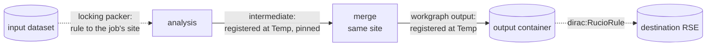

# DX-ADR-010: Rucio data management for workgraphs

## Metadata

- **Created By:** dciangot
- **Date:** 2026-10-16
- **Status:** Draft
- **Decision Maker(s):** TBD
- **Stakeholders:** Communities whose DiracX installation uses Rucio as its DM tool (catalogue excluded)

## Abstract

This ADR fills the open issue "Rucio rules for workgraph outputs" left by DX-ADR-008 and extends it to the input side. It builds on the Transformation System ADRs DX-ADR-002 to DX-ADR-009 proposed in [DIRACGrid/diracx#1042](https://github.com/DIRACGrid/diracx/pull/1042), and changes none of them.

A workgraph running in a Rucio installation can ask for two things:

- **Input locks.** Each Rucio Dataset is pinned with a Rucio rule at the storage element (RSE) of the site its job will run at, recalled from tape if need be (`dirac:RucioInputLocks`). No parcel is created until the rule is satisfied. This is done by a packer, which delays each input while its rule replicates.
- **Output transfer.** Each output file is registered where the job wrote it. A final output is then moved to its destination by one rule, declared on the workgraph output with a new `dirac:RucioRule` hint field. An intermediate output is pinned where it is until its consumer has read it, for example a merge step that runs at the same site.

Rucio stays what DX-ADR-008 says it is: a system of standing declarations, not a data backend. No parcel is ever made of a rule. DiracX creates rules, records them in an extension table, polls their state from packers and actions, and shortens their lifetime when it is done with them. Everything specific to Rucio lives in extension plugins and in the installation's catalogue implementation; the core gains a catalogue interface and nothing else.

## Motivation

DX-ADR-008 makes data management transformations RMS-driven and leaves Rucio to the communities: "declaring in the workgraph document that an output should carry a Rucio rule [...] is wanted by installations that use Rucio. Who creates the rule, who owns its lifetime, and what a workgraph's cleaning does to it are open." CMS needs an answer before can run on DiracX for non-MC workflows. CMS already uses Rucio on both sides of a job:

- **Input.** When a dataset is only on tape, or not at a site the user may run at, CMS creates a Rucio rule. The task waits until the rule is `OK` and is only then split into jobs, which run where the data is. Processing on disk-resident data relies on Rucio having placed it at the job's site.
- **Output.** job stages its output out to a local "temporary" area of the site it ran at. The file is then registered in Rucio under its final LFN, attached to the output dataset, and lets one rule on the container move everything to the user's storage site (`Site.storageSite`). Small outputs are merged first by dedicated merge step at the site.

Neither fits the ADRs as they stand:

- **A rule is not a parcel.** DX-ADR-008 rejects Rucio as a data backend because a rule is a standing declaration rather than a request that completes. Transfers and recalls therefore cannot be data transformations, and the DX-ADR-009 counters cannot see them.
- **Waiting on data has a single sanctioned place.** DX-ADR-008 says a transformation that needs files another one has replicated has "its packer delay each input until the replica exists" (DX-ADR-005, DX-ADR-006 `DelayInput`). Nothing says who creates the replica when the replication is a Rucio rule rather than another transformation.
- **Registration has no interface.** DX-ADR-003 has the core register outputs "into the installation's catalogue(s)" while a parcel is `Completing`, and DX-ADR-007 marks outputs that are not workgraph outputs as intermediate. Neither defines what a catalogue receives, so a Rucio catalogue cannot learn where a file is, whether it is intermediate, or where it should end up.
- **The end of a task is not the end of its jobs.** A task is complete when its outputs are at the destination, not when its last job ends. DX-ADR-006 has `Pending` Finalizing actions, but nothing ties them to the data.

A draft implementation of everything below, with a local stand-in for the core and a mock Rucio, is in `examples/crab-splitting/`: `crab_rucio.py` for the input side, `crab_outputs.py` for the output side, `crab-analysis-rucio.cwl` and `crab-analysis-merge.cwl` for the workgraphs.

## Specification

### Principles

1. **Rules are declarations, owned by the transformation that made them.** Every rule DiracX creates is recorded in the extension's `RucioRules` table against its transformation, with a kind (`InputDataset`, `IntermediatePin`, `Output`). Datasets on which the rule is placed are clones of the original dataset, named with a reference to the task name (allowing multiple worflows to pin the same dataset even when sharing the same rucio account). Lifetimes are what DiracX periodically checks and can extend through hooks if at least one file is requested by an unfinished job; deleting is reserved for cleaning.
2. **Nothing waits in a parcel.** The input side waits by delaying inputs (DX-ADR-005 `DelayedUntil`), so a parcel is created only once its data is in place. The output side waits in a `Pending` Finalizing action. No parcel ever sits in `Assigned` for a rule.
3. **Every Rucio call can be repeated.** Plugins run as DX-ADR-001 tasks, which are retried, and `Completing` is re-entrant (DX-ADR-003). A rule is found again by its name (tanks to clone name ref to task in point 1.) before one is created, a DID by `get_did`, and a replica or attachment that already exists is not an error.
4. **The core does not learn Rucio.** It calls a catalogue interface at `Completing` and passes on the hint fields it does not interpret. Choosing RSEs, creating rules and reading their state are the extension's.

### Services

The plugins receive their services by injection (DX-ADR-001, DX-ADR-006):

| Service              | What it is                                                                                                                                                                                                                                                                                           |
| -------------------- | ---------------------------------------------------------------------------------------------------------------------------------------------------------------------------------------------------------------------------------------------------------------------------------------------------- |
| `RucioClient`        | The subset of `rucio.client.Client` the plugins call: `list_replicas`, `list_did_rules`, `add_replication_rule`, `get_replication_rule`, `update_replication_rule`, and for registration `add_replicas`, `get_did`, `add_dataset`, `add_container`, `attach_dids`. A real client satisfies it as is. |
| `RucioRules`         | The extension's table of rules, below.                                                                                                                                                                                                                                                               |
| `RucioInputDatasets` | The extension's assignment table of DX-ADR-008 ("a destination is a decision with memory"), one row per locked dataset.                                                                                                                                                                              |
| `OutputDestination`  | The installation's catalogue, called by the core at `Completing`. A Rucio installation registers `RucioOutputDestination`.                                                                                                                                                                           |

The client is built for the Rucio account that owns the workgraph's rules: the submitting user's account for user analysis, as in CRAB, or a production account. Which one is an installation policy (see Open Issues).

```sql
CREATE TABLE RucioRules (                          -- extension-owned
    TransformationID BIGINT       NOT NULL,
    RuleID           CHAR(32)     NOT NULL,        -- Rucio rule id
    Kind             ENUM('InputLock', 'IntermediatePin', 'Output') NOT NULL,
    Scope            VARCHAR(64)  NOT NULL,
    Name             VARCHAR(512) NOT NULL,        -- file, dataset or container
    RSEExpression    VARCHAR(512) NOT NULL,
    CreatedAt        DATETIME     NOT NULL,
    ReleasedAt       DATETIME     NULL,            -- lifetime shortened
    PRIMARY KEY (TransformationID, RuleID),
    FOREIGN KEY (TransformationID) REFERENCES Transformations (TransformationID)
);

CREATE TABLE RucioInputDatasets (                     -- extension-owned
    TransformationID BIGINT       NOT NULL,
    DatasetDID              VARCHAR(512) NOT NULL,
    RSE              VARCHAR(64)  NOT NULL,
    RuleID           CHAR(32)     NOT NULL,
    Bytes            BIGINT       NOT NULL,
    Since            DATETIME     NOT NULL,
    Reroutes         INT          NOT NULL DEFAULT 0,
    PRIMARY KEY (TransformationID, LFN),
    FOREIGN KEY (TransformationID) REFERENCES Transformations (TransformationID)
);
```

### Input: lock, then pack

A locking packer wraps a community's ordinary packer (e.g. for CMS input splitting). For each claimed `Unassigned` input it makes sure the input's file is locked at a destination, and passes the input on only once the lock is satisfied:

1. **Choose.** Pick a destination RSE (or a set of) once per dataset. Clone the dataset with a new DID containing reference to the transformation and record it in `RucioInputDatasets`. Candidates that satisfied the rules are grouped by RSE and filled in order up to a configurable threshold (e.g. number of files, sum of size). Question: may we need a `dirac:RucioInputRule` workgraph new input field (?) for that?
2. **Lock.** Create a rule for the datasets at that selected RSE(s), with a lifetime and a `comment` unique to the transformation, or adopt the transformation's existing rule found by that comment. Record it in `RucioRules` as `InputLock`. A file only on tape is recalled by the lock itself; no separate recall step exists.
3. **Monitor.** Read the files's state inside a rule:
   - collect the replicas at the destination for each dataset. The input goes to the wrapped packer with that RSE's site as its only location, so the parcel's `requirements.sites` is where the data was locked.
   - if not at destination yield `DelayInput` until `now + poll_minutes`.
4. **Re-route or give up.** A `STUCK` rule, or one not `OK` after `max_wait_hours`, is released, and the file is locked at the next candidate (if any), up to `max_reroutes` times. After that the input is a `BadInput` and goes to `Problematic` for an operator (DX-ADR-005).

While any input is still on its way to a site, the packer holds back partial groups for that site as if its feeder were still active (DX-ADR-006), so a parcel is not cut short by a transfer about to finish. Locks are released by an action (below), not per parcel.

The packer's arguments, validated at submission by its model (DX-ADR-006):

| Argument                         | Meaning                                                           | CRAB equivalent                 |
| -------------------------------- | ----------------------------------------------------------------- | ------------------------------- |
| `destinations`                   | Candidate disk RSEs, in order of preference                       | `Site.whitelist`                |
| `destination_quota_bytes`        | Bytes this transformation may lock per RSE                        | Rucio quota of the lock account |
| `scope`, `activity`              | DID scope of the input, FTS activity of the rule                  | `cms`, `Analysis Input`         |
| `comment`                        | Identifies this transformation's rules; unique per transformation | the task name                   |
| `lock_lifetime_days`             | Lifetime of a lock while the transformation runs                  | rule lifetime                   |
| `poll_minutes`                   | Delay between two reads of a replicating rule                     | TaskWorker's recall polling     |
| `max_wait_hours`, `max_reroutes` | When a rule is given up, and how many other RSEs are tried        | —                               |

This is the DX-ADR-008 pattern "the consumer's packer waits on the replica", with the packer also creating the replica.

### Output: register, pin or transfer

#### Registration at `Completing`

The core registers a parcel's outputs at `Completing` (DX-ADR-003) through the installation's `OutputToDestination`. This ADR fixes the interface:

```python
@dataclass(frozen=True)
class ProducedFile:
    workgraph: str
    step: str
    output: str  # the output port
    parcel_id: UUID
    location: str  # where the job wrapper uploaded the file (a site or an RSE)
    basename: str
    bytes: int
    adler32: str
    intermediate: bool  # DX-ADR-007 TransformationOutputs.Intermediate
    hints: dict[str, JSONSerializable]  # the dirac: fields of the workgraph output


class OutputToDestination(Protocol):
    def register(self, files: list[ProducedFile]) -> list[str]:
        """Register one parcel's files and return their LFNs, in order. Idempotent."""
```

TODO: introduce a mechanism to add output rules only upon a certain threshold of workflows completion.

The returned LFNs are what the core writes as `ParcelOutputs` rows, so the catalogue owns the LFN policy. A parcel that fails registers nothing, as in DX-ADR-003. A catalogue that raises leaves the parcel in `Completing`, and the core calls it again.

`RucioOutputToDestination` does the following for each file, at the RSE the file was locally written to (the site's temporary area in CMS):

1. Compute the LFN. A workgraph output goes under the user or production area, e.g. `/store/user/<account>/<workgraph>/<step>/<output>/<basename>`. An intermediate goes under the temporary area, e.g. `/store/temp/user/...`. The per-parcel output prefix injected at scheduling (DX-ADR-007) makes basenames unique.
2. Call `add_replicas` at the RSE, with size and checksum.
3. Attach the file to the CMS dataset, creating the dataset and attaching it to the container on first use.
4. For an intermediate, register the DID in the temporary RSE only.
5. For a workgraph output with a `dirac:RucioRule`, create the `Output` rule on the container, once. Files registered later are attached to the same container and are covered by the same rule.

#### `dirac:RucioRule`

A new field on a workgraph **output parameter**, added to the `dirac:` JSON schema (DX-ADR-007). It is validated at submission and passed to the catalogue untouched:

```yaml
outputs:
  merged:
    type: File[]
    outputSource: merge/merged
    dirac:RucioRule:
      rse_expression: T2_DE_DESY
      container: /Muon/alice-Run2024A-v1/USER
      lifetime_days: 180
      activity: User Subscriptions
```

| Field            | Required | Meaning                                                                    |
| ---------------- | -------- | -------------------------------------------------------------------------- |
| `rse_expression` | yes      | Where the output must end up                                               |
| `container`      | no       | The output container; defaults to one derived from workgraph, step, output |
| `lifetime_days`  | no       | Lifetime of the rule; none by default                                      |
| `activity`       | no       | FTS activity; installation default                                         |
| `copies`         | no       | Number of copies; 1 by default                                             |

The hint sits on the workgraph output, not on a step, because an output is what a workgraph promises to deliver. A step output that is not a workgraph output is intermediate (DX-ADR-007) and is never transferred, only pinned.

#### Merging is a transformation

Merging is an ordinary compute step, edge-fed from the producer's outputs (DX-ADR-006), as in the ADR's sprucing example. Its packer is location-aware:

- it reads each input's replicas from Rucio and groups inputs by RSE, never across RSEs;
- it sends the merge parcel to that RSE's site, so the unmerged files are read locally and only merged files travel;
- it cuts a group at a minimum size, a maximum size or a maximum file count (`ParentlessMergeBySize`), and packs the remainder once the producer has drained and its feeder is off;
- an input with no replica is a `BadInput`.



Without a merge step, `dirac:RucioRule` goes on an output sourced directly from the producer, whose files are then registered as workgraph outputs and transferred unmerged.

### Actions

The rules are tied to the transformation lifecycle (DX-ADR-005) through actions (DX-ADR-006). Because members finalise upstream first, a consumer's actions run after its producer is `Finalized`.

| List         | Action                   | Result                                                                                                                                               |
| ------------ | ------------------------ | ---------------------------------------------------------------------------------------------------------------------------------------------------- |
| `Finalizing` | `ReleaseRucioInputRules` | `Done`: shortens every `InputRule` rule of the transformation to a grace period and sets `ReleasedAt`.                                               |
| `Finalizing` | `WaitForRucioTransfers`  | `Pending` while an `Output` rule replicates; `Failed` on `STUCK`, which moves the transformation to `FinalizingBlocked`; `Passed` once all are `OK`. |
| `Cleaning`   | `RemoveRucioRules`       | `Done`: deletes every rule of the transformation, including `Output` rules, so the outputs are removed as cleaning requires.                         |

`WaitForRucioTransfers` makes a workgraph `Completed` mean "the data is at its destination", which means completed task. An operator who accepts an incomplete transfer forces the action to passed, as for any failed action.

In the example in `examples/crab-splitting/` these actions are `CRABReleaseInputLocks`, `CRABWaitForTransfers` and `CRABReleaseIntermediates`. It releases intermediates at `Finalizing`, for brevity in a single run; this ADR places it in `Archiving`, where DX-ADR-006 removes intermediates.

### Accounting

Rule bytes stay outside the DX-ADR-009 counters, as DX-ADR-008 states. A locking packer budgets from `RucioInputLocks`; the authoritative limit is the Rucio account's quota at each RSE, which Rucio enforces when a rule is created. A rule refused for quota is handled as a `STUCK` rule: re-routed, then `BadInput`.

## Open Issues

- **Side effects in a packer.** DX-ADR-006 says plugins propose and the core writes; creating a rule is an external write. It is repeatable here, and the tables are the extension's, but DX-ADR-006 could name "external reservations made by a packer" explicitly, or provide a hook that runs before packing. (needed as input dataset rule creation)
- **Release per parcel.** Locks and pins are released per transformation. Releasing a file as soon as its inputs are `Processed`, or its consumer's parcel is `Done`, needs a hook on input or parcel completion that DX-ADR-006 does not define.
- **Upload location.** `ProducedFile.location` must come from the job wrapper's report of where each file was uploaded (DX-ADR-007 abandoned uploads), not from the parcel's requirements.
- **Stuck output transfers.** `WaitForRucioTransfers` blocks the transformation on a `STUCK` rule. Whether it should first try another RSE expression, and who decides, is open.
- **Schema.** `dirac:RucioRule` must be added to the published `dirac:` JSON schema (DX-ADR-007), with its defaults resolved through the configuration service like other hint fields. Same for a RUCIO input rule hint if it will be needed.
