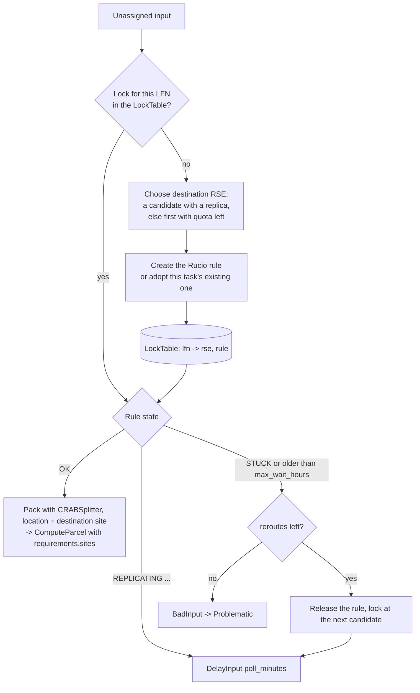

# CRAB input splitting as DiracX feeder and packer plugins (draft)

This draft reproduces the input splitting of [CRABServer](https://github.com/dmwm/CRABServer)
(TaskWorker `DataDiscovery` → `Splitter`, which runs `WMCore.JobSplitting`) in the shape the
Transformation System ADRs of [DIRACGrid/diracx#1042](https://github.com/DIRACGrid/diracx/pull/1042)
define:

- [DX-ADR-002](https://github.com/DIRACGrid/diracx/pull/1042) for the overall model.
- DX-ADR-004 for the `Inputs`, `Descriptor` and `InputHash` concepts.
- DX-ADR-005 for the input and parcel lifecycles.
- DX-ADR-006 for the feeder, packer and hook contracts.
- DX-ADR-007 for the CWL documents and `dirac:` hints.

In those ADRs the **feeder and the packer are not CWL steps**. They are Python plugins that DiracX
runs as DX-ADR-001 tasks, named by `dirac:` hints in a workgraph CWL document. The CWL document only
describes what each job runs, and it can still be run unchanged by a stock `cwltool`.

## Contents

| File                         | Role                                                                                                                                              |
| ---------------------------- | ------------------------------------------------------------------------------------------------------------------------------------------------- |
| `crab_plugins.py`            | The plugins: `CRABDBS` and `CRABPrivateMC` feeders, `CRABSplitter` packer, `CRABHandleFailedInput` hook                                           |
| `adr006.py`                  | Local stand-ins for the DX-ADR-006 proposal types (`FileInput`, `ComputeParcel`, `SplitInto`, …)                                                  |
| `crab-analysis.cwl`          | Workgraph for a CRAB Analysis task (DBS dataset, lumi mask, `LumiBased`)                                                                          |
| `crab-privatemc.cwl`         | Workgraph for a CRAB PrivateMC task (`EventBased`)                                                                                                |
| `transformations/cmsrun.cwl` | The process each parcel runs: a mock `cmsRun` that writes the DX-ADR-007 status report                                                            |
| `local_core.py`              | A local stand-in for the core: compiles the document and runs the feeder → packer → dispatch loop                                                 |
| `example_dbs.json`           | A DBS dump, the local metadata catalogue                                                                                                          |
| `example_replicas.json`      | The local replica map (DX-ADR-007)                                                                                                                |
| `test_crab_plugins.py`       | Tests                                                                                                                                             |
| `crab_rucio.py`              | Second example: `CRABRucioSplitter` packer and `CRABReleaseInputLocks` action ([below](#second-example-lock-the-input-with-rucio-before-packing)) |
| `crab-analysis-rucio.cwl`    | Workgraph for a CRAB Analysis task whose input is locked with Rucio at the job's site                                                             |
| `example_rucio.json`         | RSEs and replicas for the mock Rucio of `local_core.py --rucio`                                                                                   |
| `test_crab_rucio.py`         | Tests of the second example                                                                                                                       |

## Mapping CRAB to the Transformation System

| CRABServer / CRAB client                            | DiracX (ADR)                                                                                                                                                    |
| --------------------------------------------------- | --------------------------------------------------------------------------------------------------------------------------------------------------------------- |
| A task                                              | A workgraph with one compute transformation (`dirac:Workgraph` + one `dirac:Transformation` step)                                                               |
| A job                                               | A compute parcel: a `ComputeParcel` whose `parameters` are the CWL input object of `cmsrun.cwl`                                                                 |
| `DataDiscovery` (DBS query, `runRange`, `lumiMask`) | `CRABDBS` feeder, declared with `dirac:Feeder` on the workflow input                                                                                            |
| Per-file run/lumi info, `avgEvtsPerLumi`            | The input's `Descriptor`: `{"lumi_mask", "lumis", "events"}`; the core hashes it with the LFN (DX-ADR-004)                                                      |
| File locations                                      | Not in the descriptor (it would change the hash). The packer asks an injected `ReplicaCatalogue`, which is Rucio in production                                  |
| `Data.totalUnits`                                   | `CRABDBS` `total_units` + `unit`. How much work exists is a feeder concern (DX-ADR-006)                                                                         |
| `Data.splitting` / `unitsPerJob`                    | `CRABSplitter` packer `algorithm` / `units_per_job`                                                                                                             |
| WMCore splitting by location                        | `keep_storage_together`: a parcel never mixes files with different locations, and the locations become `requirements.sites`                                     |
| A file split across several jobs                    | Upfront chunking. The feeder yields several pre-masked inputs per LFN (`max_lumis_per_input` / `max_events_per_input`) because the packer never splits an input |
| PrivateMC `EventBased`                              | `CRABPrivateMC` feeder: one event range per input with an exact cursor bookmark, like the ADR's seed feeder. The packer makes one parcel per input              |
| `maxJobsPerTask` (PrivateMC)                        | Args-model validation, so the document is refused at submission                                                                                                 |
| `maxJobsPerTask` (data), "no job generated"         | `local_core.py --max-jobs` here. Plan: an `Approving` action over the scout, or the transformation's `Active` hook                                              |
| `Automatic` splitting: probe jobs, then sized jobs  | Scouting. Probes are `FileBased` parcels; once `events_per_second` is known the parcels are `EventAwareLumiBased` sized to `minutes_per_job`                    |
| Automatic "tail" jobs, resubmission                 | The job's status report (`SPLIT` per input) and the `CRABHandleFailedInput` hook: retry, then split the mask in two, then `Problematic`                         |
| `SplittingSummary`                                  | `splitting_summary.json`, built from parcel `metadata`. In DiracX it would come from the DX-ADR-009 counters                                                    |

### Packer behaviour (DX-ADR-006)

- **Streaming.** The packer receives a generator of claimed `Unassigned` inputs and buffers at most one
    partial parcel per set of locations.
- **Draining.** A partial group is proposed only when the feeder is off (`feeder_active=False`) or on
    `flush`. Otherwise its inputs are not proposed and they stay `Unassigned` for the next sweep. During
    a scout the remainder is therefore held back until the scout is extended or flushed.
- **Bad inputs.** An input with no replica, or one with no lumi mask under a lumi algorithm, is
    returned as `BadInput` and ends `Problematic`.

### Feeder behaviour

- **One pass per dataset.** A CRAB task processes a snapshot of its dataset, so `CRABDBS` makes one
    full pass and then yields `NoMoreInputs`. Its bookmark (`{"complete": true}`) avoids re-querying DBS.
- **Deterministic selection.** Every pass recomputes the same selection: files sorted by LFN and
    truncated by `total_units`. Re-yielded inputs are therefore dropped by the core's unique `InputHash`,
    and the feeder does not need to remember what it yielded.
- **Scouting.** The scout is a stable hash-based sample of that selection (`scouting_fraction`). It
    does not exhaust the feeder, and the inputs it yields are deduplicated when the full pass runs after
    approval.

## Running it

```bash
cd examples/crab-splitting

# Every document is plain CWL: a stock runner ignores the dirac: hints
echo '{"input-data": ["lfn:/store/x.root"]}' > job.json
cwltool --no-container crab-analysis.cwl job.json

# Submission + one feeder/packer sweep: writes out/analysis/parcels/*.json and the summary
python3 local_core.py crab-analysis.cwl --dbs example_dbs.json --replicas example_replicas.json

# Scouting: the sample is packed and the remainder is held back while the feeder is still enabled
python3 local_core.py crab-analysis.cwl --dbs example_dbs.json --replicas example_replicas.json --scouting

# Dispatch every parcel with cwltool and apply the status reports. max-lumis simulates a
# wall-time limit, so jobs report SPLIT and the unprocessed lumis are packed again
python3 local_core.py crab-analysis.cwl --dbs example_dbs.json --replicas example_replicas.json \
    --run --set max-lumis=2

# PrivateMC
python3 local_core.py crab-privatemc.cwl --run

# Rucio input locks (second example, below): simulated time, mock Rucio
python3 local_core.py crab-analysis-rucio.cwl --dbs example_dbs.json --rucio example_rucio.json --run

# Tests (outside the repository's pytest configuration)
python3 -m pytest -c /dev/null -p no:cacheprovider test_crab_plugins.py test_crab_rucio.py
```

Requirements: `pydantic`, `pyyaml`, and `cwltool` with node.js for `--run`.

## Integration plan

The preferred plan is to keep **CMS-specific code out of DiracX core**. The CRAB plugins should live
in a CMS DiracX extension, built like `extensions/gubbins`, and be registered through entry points.
DiracX core provides only the generic machinery the ADRs define.

1. **Keep the plugins as they are, and track the ADR types.** The plugins are written to the
    DX-ADR-006 signatures: keyword-only arguments, a pydantic args model, and generators that yield
    proposals. When DiracX publishes the real types, `adr006.py` is deleted and its imports point at
    the DiracX module. Nothing else changes, because the plugins already follow "plugins propose, the
    core writes".

2. **Package them in a CMS extension.** For example `cmsdiracx-tasks`, registered under entry-point
    groups such as:

    ```toml
    [project.entry-points."diracx.transformations.feeders"]
    CRABDBS = "cmsdiracx.transformations.crab:crab_dbs_feeder"
    CRABPrivateMC = "cmsdiracx.transformations.crab:crab_private_mc_feeder"
    [project.entry-points."diracx.transformations.packers"]
    CRABSplitter = "cmsdiracx.transformations.crab:crab_splitter_packer"
    [project.entry-points."diracx.transformations.hooks"]
    CRABHandleFailedInput = "cmsdiracx.transformations.crab:crab_handle_failed_input"
    ```

    The group names are a proposal: DX-ADR-006 leaves discovery and versioning open. `local_core.py`
    already looks plugins up through these groups before falling back to the local registry.

3. **Swap the injected services.** `DBSClient` and `ReplicaCatalogue` are protocols. In the
    extension they become DX-ADR-001 injectable dependencies, a DBS client and a Rucio replica lookup,
    requested by annotation exactly as the ADR's `bk_db: BookkeepingDB`. The JSON implementations stay
    for tests and CI, which is DX-ADR-007's "replica map as a JSON file".

4. **Defaults from the configuration service.** Move the `DEFAULT_*` constants
    (`maxJobsPerTask`, `numAutomaticProbes`, `minAutomaticRuntimeMins`, the scouting fraction) to CS
    values. Resolve them against the workgraph `type` (`CRABAnalysis`, `CRABPrivateMC`) together with
    default hook bindings and action lists, so that CRAB documents stay short.

5. **Translate the CRAB client.** `crab submit` builds the workgraph document from `crabConfig.py`
    using the table in `crab-analysis.cwl`'s header comment, and submits it. The lumi mask is inlined
    in the `dirac:Feeder` args, or passed as a `sandbox:` reference when it is large. The `JobType`
    pset becomes the step's `run` body, stored content-addressed.

6. **The cmsRun wrapper writes the status report.** The real job wrapper derives the DX-ADR-007
    status report from the framework job report: `SUCCESS` per input, `SPLIT` with the processed and
    unprocessed lumi masks when a job stops early, and `NOT_TRIED` otherwise. This replaces CRAB's
    PostJob and tail-job machinery for recovering lumis.

7. **Automatic splitting through scouting.** The `CRABAnalysis` workgraph type binds an `Approving`
    list (`CheckSuccessRate`, `EstimateResourceUsage`) that measures throughput on the scout parcels.
    See open issue 1 for how the result reaches the packer.

8. **Upstream the generic pieces.** Contribute these to DiracX rather than keeping them CMS-only:

    - the `local_core.py` behaviours, as the DiracX core's own implementation: hash deduplication, the
        drain rule, and status-report application;
    - the `dirac:StatusReport` output marker;
    - a JSON-catalogue feeder for tests.

### Open issues found while mapping

1. **Packer arguments are not adjustable by hooks.** In DX-ADR-006 an `Operation` changes feeder
    arguments only. Automatic splitting needs the throughput measured during the scout to reach the
    packer as `events_per_second`. Options:
    - let `ActionResult.updated_requirements` feed the packer through the requirements template, which
        the packer would then need to receive;
    - inject a "scout measurements" service into the packer;
    - add `packer_args` to `Operation`.
2. **The status-report marker.** DX-ADR-007 leaves the output marker unsettled. This draft uses
    `dirac:StatusReport: true` on the output parameter, an extension field like `dirac:Feeder`.
3. **Per-parcel inputs.** For the job to key its status report by input id, the parcel must carry
    the ids. Here the packer puts them in an `inputs-manifest` parameter. It may be cleaner for the
    resolution layer to inject them as a standard per-parcel value, the way the output prefix is
    injected.
4. **`NOT_TRIED`, and inputs missing from a report.** These are left open by DX-ADR-005 and
    DX-ADR-006. This draft returns `NOT_TRIED` inputs straight to `Unassigned`, and treats an input
    absent from the report as `FAILURE`.
5. **Chunk granularity versus row count.** Upfront chunking with `max_lumis_per_input = 1`
    reproduces WMCore lumi packing exactly, at the cost of one `Inputs` row per lumi. Larger chunks
    need far fewer rows but can leave short parcels at chunk boundaries. `total_units` is also
    honoured at chunk granularity, not exactly.
6. **The `maxJobsPerTask` guard for data tasks.** The parcel count for a data task is only known
    after packing, so the guard cannot be a submission check. Candidates are an `Approving` action
    that extrapolates from the scout, or an `Active` hook that disables the feeder.

## Second example: lock the input with Rucio before packing

The request: lock the input data, and wait until it is at the site a job will run at before creating
the job's parcel, using Rucio. `crab-analysis-rucio.cwl` is `crab-analysis.cwl` with the packer
replaced by `CRABRucioSplitter`. That packer is in `crab_rucio.py` and reuses the `CRABSplitter`
grouping.

### Where it fits in the ADRs

The ADRs already have a place for this wait, and it is the packer:

- DX-ADR-005: an input stays `Unassigned` with a `DelayedUntil` while "the packer asks for the
    delay, for example because a file is not yet at the storage element the transformation needs".
- DX-ADR-008: "a transformation that needs files another one has replicated [...] its packer delays
    each input until the replica exists".
- DX-ADR-008: "a destination is a decision with memory [...] the assignment table belongs to its
    extension".

So the lock and the wait are a packer concern, and its memory is an extension table. Two
alternatives fit worse:

- **Rucio as a data backend**, where a lock is a `DataParcel` that completes when the rule is OK.
    DX-ADR-008 rejects this explicitly: a rule is a standing declaration, not a request that
    completes.
- **A separate staging transformation upstream.** Data transformations are sinks (DX-ADR-008), so
    the compute step could not be edge-fed from it. It would still need the same delay in its packer,
    and it would have to choose a destination without knowing where the job will run, which is the
    packing decision.

### What the packer does with each claimed input



- **One lock per LFN, not per input.** Every lumi chunk of a file shares the same rule and the same
    destination, through the extension's `LockTable`.
- **Destination choice.** The packer tries the candidates in `destinations` (CRAB's
    `Site.whitelist`, as disk RSEs) in order:
    - A candidate that already holds the file wins, and the rule only pins the replica there.
    - Otherwise the first candidate that is within `destination_quota_bytes` is chosen. This fills one
        site before the next, which keeps the files of a job together. Pinned bytes count against the
        quota too, as they do in a Rucio account's usage.
- **Tape-only files.** These need nothing extra: the rule at a disk RSE makes Rucio recall the file
    from tape and transfer it.
- **Idempotent.** The rule's `comment` identifies the task. If the packer task dies between creating
    the rule and writing the table, the next sweep finds and adopts the rule instead of creating
    another one, which Rucio would refuse as a `DuplicateRule` anyway.
- **Parcels wait for transfers to their own site only.** A partial group for a site is held back
    only while a transfer to that same site is still running. A transfer still running to CNAF does
    not hold back a Legnaro job.
- **The parcel runs where its data is.** `requirements.sites` is the destination's site, and
    `metadata.locks` records which RSE each file was locked at.
- **Release.** The `CRABReleaseInputLocks` Finalizing action shortens every rule of the task to
    `grace_hours`, and Rucio expires them. The rules carry `lock_lifetime_days` from the start, so the
    locks also expire if the task is abandoned.

The injected services are typed by protocols:

- `RucioClient` is the subset of `rucio.client.Client` the plugins call: `list_replicas`,
    `list_did_rules`, `add_replication_rule`, `get_replication_rule` and `update_replication_rule`. A
    real client satisfies it as is.
- `LockTable` is the extension's table, one row per (transformation, LFN).
- `Clock` exists so that the harness can simulate time.

### The run in `example_rucio.json`

| File | Where it is                   | What happens                                                                                                                   | Parcel created |
| ---- | ----------------------------- | ------------------------------------------------------------------------------------------------------------------------------ | -------------- |
| f1   | `T2_IT_Legnaro`               | Pinned in place, rule `OK` at once                                                                                             | cycle 0        |
| f2   | `T2_IT_Legnaro`               | Pinned in place, rule `OK` at once                                                                                             | cycle 0        |
| f4   | `T2_DE_DESY`, not whitelisted | Replicated to Legnaro, which still has quota, in 30 min                                                                        | cycle 2        |
| f3   | `T1_IT_CNAF_Tape` only        | Legnaro is over quota, so the rule goes to `T2_IT_Pisa`, which goes `STUCK`. It is re-routed to `T1_IT_CNAF_Disk` and recalled | cycle 19       |

Each cycle is 15 simulated minutes. After the last parcel, the Finalizing action releases the four
locks.

### Integration

The integration follows the same plan as the first example, with one addition. The CMS extension
provides:

- the Rucio client, as a DX-ADR-001 dependency built from the task's (or a service) account;
- a `LockTable` backed by an extension-owned table keyed on `(TransformationID, LFN)`.

`MockRucio` and `InMemoryLockTable` in `local_core.py` stand in for them here.

### Open issues specific to locking

1. **Side effects in a packer.** DX-ADR-006 says that plugins propose and the core writes, but
    creating a rule is an external write. The draft makes it safe to repeat (adopting the rule by its
    comment), and the lock table is the extension's own. Whether DX-ADR-006 should name "external
    reservations made by a packer" explicitly, or offer a hook that runs before packing, is worth
    raising.
2. **Shared rules.** Rucio refuses a second rule for the same DID, account and RSE expression. Two
    tasks of one account locking the same file at the same RSE therefore need to share one rule,
    which means reference counting before a release. Alternatives are a rule per task through a
    distinct account, or a cross-transformation lock table.
3. **The input is delayed, not the parcel.** The packer holds inputs until they are ready, so a
    parcel never waits in `Assigned`. The cost is a `get_replication_rule` call per locked file per
    sweep. Polling per rule could become per dataset (CMS block) if rules were created per block,
    which would also be closer to CRAB's tape recall, at the cost of coarser destination choices.
4. **The core does not see the locked bytes.** They are outside the DX-ADR-009 counters
    (DX-ADR-008: "files a rule moves are outside the counters"). The quota check reads the lock
    table, and the authoritative limit is the Rucio account quota.
5. **Releasing per parcel.** Locks are released at Finalizing. Releasing a file as soon as all of
    its inputs are `Processed` would need a hook on input or parcel completion, which DX-ADR-006 does
    not define.
