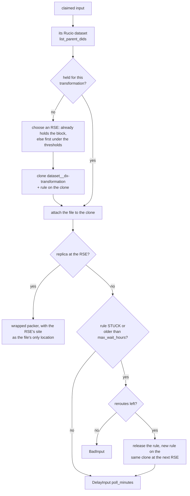
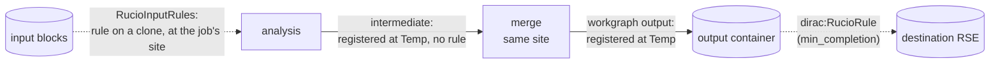

# CRAB input splitting as DiracX feeder and packer plugins (draft)

This draft reproduces the input splitting of [CRABServer](https://github.com/dmwm/CRABServer)
(TaskWorker `DataDiscovery` → `Splitter`, which runs `WMCore.JobSplitting`) in the shape the
Transformation System ADRs of [DIRACGrid/diracx#1042](https://github.com/DIRACGrid/diracx/pull/1042)
define:

- [DX-ADR-002](https://github.com/DIRACGrid/diracx/pull/1042) for the overall model.
- DX-ADR-004 for the `Inputs`, `Descriptor` and `InputHash` concepts.
- DX-ADR-005 for the input and parcel lifecycles.
- DX-ADR-006 for the feeder, packer and hook contracts.
- DX-ADR-007 for the CWL documents and `dirac:` hints.

In those ADRs the **feeder and the packer are not CWL steps**. They are Python plugins that DiracX
runs as DX-ADR-001 tasks, named by `dirac:` hints in a workgraph CWL document. The CWL document only
describes what each job runs, and it can still be run unchanged by a stock `cwltool`.

## Contents

| File                                            | Role                                                                                                                                                             |
| ----------------------------------------------- | ---------------------------------------------------------------------------------------------------------------------------------------------------------------- |
| `crab_plugins.py`                               | The plugins: `CRABDBS` and `CRABPrivateMC` feeders, `CRABSplitter` packer, `CRABHandleFailedInput` hook                                                          |
| `adr006.py`                                     | Local stand-ins for the DX-ADR-006 proposal types (`FileInput`, `ComputeParcel`, `SplitInto`, …)                                                                 |
| `crab-analysis.cwl`                             | Workgraph for a CRAB Analysis task (DBS dataset, lumi mask, `LumiBased`)                                                                                         |
| `crab-privatemc.cwl`                            | Workgraph for a CRAB PrivateMC task (`EventBased`)                                                                                                               |
| `transformations/cmsrun.cwl`                    | The process each parcel runs: a mock `cmsRun` that writes the DX-ADR-007 status report                                                                           |
| `local_core.py`                                 | A local stand-in for the core: compiles the document and runs the feeder → packer → dispatch loop                                                                |
| `example_dbs.json`                              | A DBS dump, the local metadata catalogue                                                                                                                         |
| `example_replicas.json`                         | The local replica map (DX-ADR-007)                                                                                                                               |
| `test_crab_plugins.py`                          | Tests                                                                                                                                                            |
| `rucio_common.py`                               | Rucio data management ([below](#rucio-data-management-dx-adr-010)): client protocol, extension tables, rule helpers                                              |
| `rucio_inputs.py`                               | `dirac:RucioInputRule`, the `RucioInputRules` packer that wraps the step's packer, the `ReleaseRucioInputRules` action                                           |
| `rucio_outputs.py`                              | `OutputToDestination` / `RucioOutputToDestination`, `dirac:RucioRule`, the `RucioMergeBySize` packer, the `WaitForRucioTransfers` and `RemoveRucioRules` actions |
| `rucio_hooks.py`                                | `RucioRuleKeeper`, the transformation's `Active` hook: renews rule lifetimes, creates output rules at `min_completion`                                           |
| `rucio-input-rules.cwl`                         | Workgraph: CMS analysis whose input blocks are held by Rucio rules at the jobs' sites                                                                            |
| `rucio-merge-transfer.cwl`                      | Workgraph: the same analysis → merge by size where the outputs are → Rucio rule to the storage site                                                              |
| `transformations/merge.cwl`                     | The process each merge parcel runs: a mock EDM merge                                                                                                             |
| `example_rucio.json`                            | RSEs, replicas and input blocks for the mock Rucio of `local_core.py --rucio`                                                                                    |
| `test_rucio_inputs.py`, `test_rucio_outputs.py` | Tests of the Rucio plugins                                                                                                                                       |

## Mapping CRAB to the Transformation System

| CRABServer / CRAB client                            | DiracX (ADR)                                                                                                                                                    |
| --------------------------------------------------- | --------------------------------------------------------------------------------------------------------------------------------------------------------------- |
| A task                                              | A workgraph with one compute transformation (`dirac:Workgraph` + one `dirac:Transformation` step)                                                               |
| A job                                               | A compute parcel: a `ComputeParcel` whose `parameters` are the CWL input object of `cmsrun.cwl`                                                                 |
| `DataDiscovery` (DBS query, `runRange`, `lumiMask`) | `CRABDBS` feeder, declared with `dirac:Feeder` on the workflow input                                                                                            |
| Per-file run/lumi info, `avgEvtsPerLumi`            | The input's `Descriptor`: `{"lumi_mask", "lumis", "events"}`; the core hashes it with the LFN (DX-ADR-004)                                                      |
| File locations                                      | Not in the descriptor (it would change the hash). The packer asks an injected `ReplicaCatalogue`, which is Rucio in production                                  |
| `Data.totalUnits`                                   | `CRABDBS` `total_units` + `unit`. How much work exists is a feeder concern (DX-ADR-006)                                                                         |
| `Data.splitting` / `unitsPerJob`                    | `CRABSplitter` packer `algorithm` / `units_per_job`                                                                                                             |
| WMCore splitting by location                        | `keep_storage_together`: a parcel never mixes files with different locations, and the locations become `requirements.sites`                                     |
| A file split across several jobs                    | Upfront chunking. The feeder yields several pre-masked inputs per LFN (`max_lumis_per_input` / `max_events_per_input`) because the packer never splits an input |
| PrivateMC `EventBased`                              | `CRABPrivateMC` feeder: one event range per input with an exact cursor bookmark, like the ADR's seed feeder. The packer makes one parcel per input              |
| `maxJobsPerTask` (PrivateMC)                        | Args-model validation, so the document is refused at submission                                                                                                 |
| `maxJobsPerTask` (data), "no job generated"         | `local_core.py --max-jobs` here. Plan: an `Approving` action over the scout, or the transformation's `Active` hook                                              |
| `Automatic` splitting: probe jobs, then sized jobs  | Scouting. Probes are `FileBased` parcels; once `events_per_second` is known the parcels are `EventAwareLumiBased` sized to `minutes_per_job`                    |
| Automatic "tail" jobs, resubmission                 | The job's status report (`SPLIT` per input) and the `CRABHandleFailedInput` hook: retry, then split the mask in two, then `Problematic`                         |
| `SplittingSummary`                                  | `splitting_summary.json`, built from parcel `metadata`. In DiracX it would come from the DX-ADR-009 counters                                                    |

### Packer behaviour (DX-ADR-006)

- **Streaming.** The packer receives a generator of claimed `Unassigned` inputs and buffers at most one
    partial parcel per set of locations.
- **Draining.** A partial group is proposed only when the feeder is off (`feeder_active=False`) or on
    `flush`. Otherwise its inputs are not proposed and they stay `Unassigned` for the next sweep. During
    a scout the remainder is therefore held back until the scout is extended or flushed.
- **Bad inputs.** An input with no replica, or one with no lumi mask under a lumi algorithm, is
    returned as `BadInput` and ends `Problematic`.

### Feeder behaviour

- **One pass per dataset.** A CRAB task processes a snapshot of its dataset, so `CRABDBS` makes one
    full pass and then yields `NoMoreInputs`. Its bookmark (`{"complete": true}`) avoids re-querying DBS.
- **Deterministic selection.** Every pass recomputes the same selection: files sorted by LFN and
    truncated by `total_units`. Re-yielded inputs are therefore dropped by the core's unique `InputHash`,
    and the feeder does not need to remember what it yielded.
- **Scouting.** The scout is a stable hash-based sample of that selection (`scouting_fraction`). It
    does not exhaust the feeder, and the inputs it yields are deduplicated when the full pass runs after
    approval.

## Running it

```bash
cd examples/crab-splitting

# Every document is plain CWL: a stock runner ignores the dirac: hints
echo '{"input-data": ["lfn:/store/x.root"]}' > job.json
cwltool --no-container crab-analysis.cwl job.json

# Submission + one feeder/packer sweep: writes out/analysis/parcels/*.json and the summary
python3 local_core.py crab-analysis.cwl --dbs example_dbs.json --replicas example_replicas.json

# Scouting: the sample is packed and the remainder is held back while the feeder is still enabled
python3 local_core.py crab-analysis.cwl --dbs example_dbs.json --replicas example_replicas.json --scouting

# Dispatch every parcel with cwltool and apply the status reports. max-lumis simulates a
# wall-time limit, so jobs report SPLIT and the unprocessed lumis are packed again
python3 local_core.py crab-analysis.cwl --dbs example_dbs.json --replicas example_replicas.json \
    --run --set max-lumis=2

# PrivateMC
python3 local_core.py crab-privatemc.cwl --run

# Rucio input rules (DX-ADR-010, below): simulated time, mock Rucio
python3 local_core.py rucio-input-rules.cwl --dbs example_dbs.json --rucio example_rucio.json --run

# Outputs registered in Rucio, merged and transferred (DX-ADR-010, below)
python3 local_core.py rucio-merge-transfer.cwl --dbs example_dbs.json --rucio example_rucio.json --run

# Tests (outside the repository's pytest configuration)
python3 -m pytest -c /dev/null -p no:cacheprovider test_crab_plugins.py test_rucio_inputs.py test_rucio_outputs.py
```

Requirements: `pydantic`, `pyyaml`, and `cwltool` with node.js for `--run`.

## Integration plan

The preferred plan is to keep **CMS-specific code out of DiracX core**. The CRAB plugins should live
in a CMS DiracX extension, built like `extensions/gubbins`, and be registered through entry points.
DiracX core provides only the generic machinery the ADRs define.

1. **Keep the plugins as they are, and track the ADR types.** The plugins are written to the
    DX-ADR-006 signatures: keyword-only arguments, a pydantic args model, and generators that yield
    proposals. When DiracX publishes the real types, `adr006.py` is deleted and its imports point at
    the DiracX module. Nothing else changes, because the plugins already follow "plugins propose, the
    core writes".

2. **Package them in a CMS extension.** For example `cmsdiracx-tasks`, registered under entry-point
    groups such as:

    ```toml
    [project.entry-points."diracx.transformations.feeders"]
    CRABDBS = "cmsdiracx.transformations.crab:crab_dbs_feeder"
    CRABPrivateMC = "cmsdiracx.transformations.crab:crab_private_mc_feeder"
    [project.entry-points."diracx.transformations.packers"]
    CRABSplitter = "cmsdiracx.transformations.crab:crab_splitter_packer"
    [project.entry-points."diracx.transformations.hooks"]
    CRABHandleFailedInput = "cmsdiracx.transformations.crab:crab_handle_failed_input"
    ```

    The group names are a proposal: DX-ADR-006 leaves discovery and versioning open. `local_core.py`
    already looks plugins up through these groups before falling back to the local registry.

3. **Swap the injected services.** `DBSClient` and `ReplicaCatalogue` are protocols. In the
    extension they become DX-ADR-001 injectable dependencies, a DBS client and a Rucio replica lookup,
    requested by annotation exactly as the ADR's `bk_db: BookkeepingDB`. The JSON implementations stay
    for tests and CI, which is DX-ADR-007's "replica map as a JSON file".

4. **Defaults from the configuration service.** Move the `DEFAULT_*` constants
    (`maxJobsPerTask`, `numAutomaticProbes`, `minAutomaticRuntimeMins`, the scouting fraction) to CS
    values. Resolve them against the workgraph `type` (`CRABAnalysis`, `CRABPrivateMC`) together with
    default hook bindings and action lists, so that CRAB documents stay short.

5. **Translate the CRAB client.** `crab submit` builds the workgraph document from `crabConfig.py`
    using the table in `crab-analysis.cwl`'s header comment, and submits it. The lumi mask is inlined
    in the `dirac:Feeder` args, or passed as a `sandbox:` reference when it is large. The `JobType`
    pset becomes the step's `run` body, stored content-addressed.

6. **The cmsRun wrapper writes the status report.** The real job wrapper derives the DX-ADR-007
    status report from the framework job report: `SUCCESS` per input, `SPLIT` with the processed and
    unprocessed lumi masks when a job stops early, and `NOT_TRIED` otherwise. This replaces CRAB's
    PostJob and tail-job machinery for recovering lumis.

7. **Automatic splitting through scouting.** The `CRABAnalysis` workgraph type binds an `Approving`
    list (`CheckSuccessRate`, `EstimateResourceUsage`) that measures throughput on the scout parcels.
    See open issue 1 for how the result reaches the packer.

8. **Upstream the generic pieces.** Contribute these to DiracX rather than keeping them CMS-only:

    - the `local_core.py` behaviours, as the DiracX core's own implementation: hash deduplication, the
        drain rule, and status-report application;
    - the `dirac:StatusReport` output marker;
    - a JSON-catalogue feeder for tests.

### Open issues found while mapping

1. **Packer arguments are not adjustable by hooks.** In DX-ADR-006 an `Operation` changes feeder
    arguments only. Automatic splitting needs the throughput measured during the scout to reach the
    packer as `events_per_second`. Options:
    - let `ActionResult.updated_requirements` feed the packer through the requirements template, which
        the packer would then need to receive;
    - inject a "scout measurements" service into the packer;
    - add `packer_args` to `Operation`.
2. **The status-report marker.** DX-ADR-007 leaves the output marker unsettled. This draft uses
    `dirac:StatusReport: true` on the output parameter, an extension field like `dirac:Feeder`.
3. **Per-parcel inputs.** For the job to key its status report by input id, the parcel must carry
    the ids. Here the packer puts them in an `inputs-manifest` parameter. It may be cleaner for the
    resolution layer to inject them as a standard per-parcel value, the way the output prefix is
    injected.
4. **`NOT_TRIED`, and inputs missing from a report.** These are left open by DX-ADR-005 and
    DX-ADR-006. This draft returns `NOT_TRIED` inputs straight to `Unassigned`, and treats an input
    absent from the report as `FAILURE`.
5. **Chunk granularity versus row count.** Upfront chunking with `max_lumis_per_input = 1`
    reproduces WMCore lumi packing exactly, at the cost of one `Inputs` row per lumi. Larger chunks
    need far fewer rows but can leave short parcels at chunk boundaries. `total_units` is also
    honoured at chunk granularity, not exactly.
6. **The `maxJobsPerTask` guard for data tasks.** The parcel count for a data task is only known
    after packing, so the guard cannot be a submission check. Candidates are an `Approving` action
    that extrapolates from the scout, or an `Active` hook that disables the feeder.

## Rucio data management (DX-ADR-010)

[DX-ADR-010](../../docs/adr/DX-ADR-010_rucio_data_management.md) specifies how a workgraph uses
Rucio for its inputs and its outputs. The plugins in `rucio_*.py` implement it; nothing in them is
CRAB-specific, so they serve CMS analysis and production alike, and wrap any community packer.

### Input: one rule per dataset, on a clone

A driving input that carries `dirac:RucioInputRule` next to its `dirac:Feeder` has its step's packer
(`CRABSplitter` here) wrapped in `RucioInputRules`, with the hint as arguments:

```yaml
inputs:
  input-data:
    dirac:Feeder: {name: CRABDBS, args: {dataset: /Muon/Run2024A-PromptReco-v1/MINIAOD}}
    dirac:RucioInputRule:
      destinations: [T2_IT_Legnaro, T2_IT_Pisa, T1_IT_CNAF_Disk]
      clone_scope: user.cmsuser
      max_bytes_per_rse: 2000000
```



- A rule per **dataset** (CMS block), not per file: one rule to create, renew and poll per block.
- The rule is on a **clone** named after the transformation, holding only the files the
    transformation is fed. Two workgraphs, even of the same Rucio account, never share a rule; a
    retried task finds the clone by its name and the rule by its DID, RSE and comment.
- Readiness is **per file**: a file at the destination is packed while the rest of its block is still
    on its way, but a partial group for that site is held back until the transfers to it end.
- The `RucioRuleKeeper` **`Active` hook** renews a rule's lifetime while a file of its clone is still
    needed by an unfinished input. `ReleaseRucioInputRules` shortens them at `Finalizing`, and
    `RemoveRucioRules` deletes every rule of the transformation at `Cleaning`.

`rucio-input-rules.cwl` on `example_rucio.json`: block A (`f1`, `f2`) is at `T2_IT_Legnaro` and is only
pinned there, so its parcels are created at once. Block B (`f3` on tape, `f4` at DESY) no longer
fits Legnaro's 2 MB threshold, goes to `T2_IT_Pisa`, whose rule ends `STUCK` after the recall, and is
re-routed to `T1_IT_CNAF_Disk`; its parcels run there.

### Output: register where written, merge there, one rule to the destination

The core registers a parcel's outputs at `Completing` through `OutputToDestination`;
`RucioOutputToDestination` declares each file at the temporary RSE of the site it was written at and
attaches it to a dataset of its container. An intermediate (a step output that is not a workgraph
output) gets no rule: its consumer, `RucioMergeBySize`, reads it where it is, grouping files by RSE.
A workgraph output with `dirac:RucioRule` gets one rule on its container, at once or, with
`min_completion`, once that fraction of the transformation's inputs is processed. The
`WaitForRucioTransfers` `Finalizing` action keeps the transformation open until the rule is `OK`.



`rucio-merge-transfer.cwl` on the same data: five analysis parcels write unmerged files at
`T2_IT_Legnaro_Temp` and `T1_IT_CNAF_Temp`, and the merge step merges them per site. The output sets
`min_completion: 0.5`, which only counts once the merge's feeder is exhausted; here that happens in
the cycle in which the last merges run, so the container rule to `T2_DE_DESY` is created by
`WaitForRucioTransfers`, which then keeps the merge transformation `Finalizing` until the rule is `OK`.

### Integration

The Rucio plugins belong in the CMS extension with the CRAB ones, behind the entry points of the
integration plan above. They need from the extension:

- a `RucioClient` built for the account that owns the rules (the user's for analysis, a production
    account otherwise);
- the `RucioRules`, `RucioInputDatasets` and `RucioOutputContainers` tables (`RucioTables`), keyed on
    `TransformationID`;
- the installation's `OutputToDestination`, registered as `RucioOutputToDestination`.

And from the core, beyond DX-ADR-002..009 (see DX-ADR-010's open issues): the `OutputToDestination`
call at `Completing`, packer wrapping for `dirac:RucioInputRule`, and a read-only `LiveInputs` view for
the `Active` hook. `local_core.py` provides all three, with `MockRucio` and `InMemoryRucioTables`.
